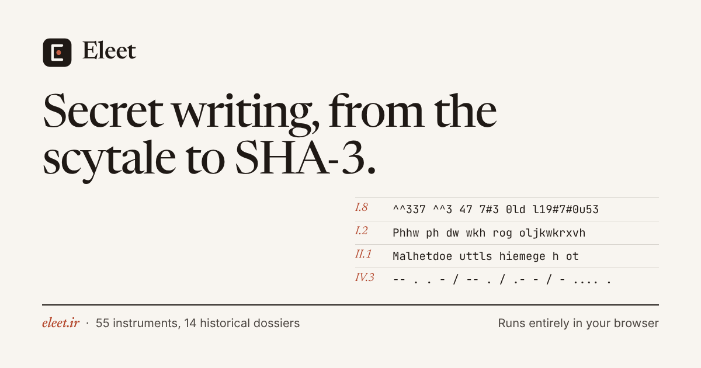
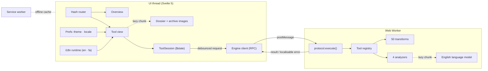

<div align="center">


# Eleet

**A cabinet of secret writing — from the scytale to SHA-3.**

55 instruments · 14 historical dossiers · English & فارسی (RTL) · light & dark · works offline · nothing you type ever leaves your browser

[**eleet.ir**](https://eleet.ir) · [Architecture](docs/ARCHITECTURE.md) · [Engine guide](docs/ENGINE.md) · [Algorithms](docs/ALGORITHMS.md) · [Design system](docs/DESIGN.md) · [Contributing](CONTRIBUTING.md)




</div>

---

## Contents

- [Why Eleet](#why-eleet)
- [Highlights](#highlights)
- [Tool catalogue](#tool-catalogue)
- [Privacy & security model](#privacy--security-model)
- [Architecture at a glance](#architecture-at-a-glance)
- [Technology choices](#technology-choices)
- [Getting started](#getting-started)
- [Project structure](#project-structure)
- [Quality gates](#quality-gates)
- [Deployment](#deployment)
- [Browser support](#browser-support)
- [Accessibility & internationalisation](#accessibility--internationalisation)
- [Contributing](#contributing)
- [License & credits](#license--credits)

## Why Eleet

Text transformation tools on the web tend to be one of two things: single-purpose pages full of
ads that post your text to a server, or powerful developer workbenches with a steep learning
curve. Eleet aims for the space between — a carefully designed, bilingual cabinet that treats
**cryptographic history, hacker culture and Unicode** as one subject, files every instrument by
what it actually does to text, and runs **entirely in the browser** so it can be trusted with
anything you paste into it.

The name is _elite_ spelled the way the 1980s bulletin boards spelled it. Its mark is a capital E
whose middle arm has been replaced by a single dot — **·** is E in Morse code, the shortest signal of
all, given to E because it is the most frequent letter in English: substitution and frequency, the
two oldest ideas in the cabinet, in one letter.

## Highlights

- **An overview, not a default tool.** The front page is set like the opening of a printed
  catalogue: a live **specimen sheet** that runs one line of your text through fourteen instruments
  at once, the catalogue in its ten numbered drawers, plates from the archive, and the house rules.
- **Historical dossiers.** Fourteen instruments carry an illustrated essay in both languages —
  Caesar and Suetonius, the Spartan scytale, Atbash in Jeremiah, Bellaso and Vigenère, Playfair and
  PT-109, Enigma and Bletchley, Bacon’s _omnia per omnia_, Morse and Vail, Louis Braille, Polybius and
  the Hanoi tap code, al-Kindi and the Babington plot, Room 40 and the Zimmermann telegram,
  Trithemius’s _Steganographia_, and the BBS origins of leet — with **public-domain archival images**
  (key sheets, manuscripts, telegrams, portraits) and dated **dispatches** that load straight into
  the workbench. The worked example of the 1930 Enigma manual and Bacon’s own 1623 example decrypt
  exactly, and are pinned by tests.
- **A serious, deterministic leet engine.** Four glyph tiers (readable → hardcore ASCII art → Cyrillic look-alikes),
  density and seeded randomness, scene slang (`teh`, `pwn3d`, `n00b`), leet morphology (`-xor`, `-z`),
  an editable A–Z **glyph matrix**, and a **probabilistic decoder** — a beam search over an English
  bigram model and a 6 000-word vocabulary that reads `|-|3|_|_0 \/\/0|2|_|)` back as “hello world”
  (98–100 % word accuracy on hardcore leet in our benchmarks). Every built-in preset is
  **collision-free** — no two letters share a glyph and no glyph is a plain letter — so _i_ becomes
  `1` while _l_ stays `l`; ambiguous folk glyphs are still understood by the decoder.
- **Real cryptanalysis.** A cipher cracker that breaks Caesar, affine, Atbash, rail fence, short
  columnar keys and **Vigenère/Beaufort** (Friedman’s index of coincidence + χ²) without the key, a
  **Magic** auto-decoder that peels nested encodings (Base64 inside hex inside ROT13…), and
  frequency analysis with cipher fingerprinting.
- **History you can touch.** A faithful **Enigma I/M3** (reflectors A, B and C, ring settings,
  plugboard, the double-stepping anomaly, a live lampboard), a **scytale** that draws its rod and
  strip as you type, a **Morse transmitter** you can hear, see and download as WAV, Playfair,
  Polybius/ADFGX, Bacon’s steganographic biliteral cipher and more.
- **Unicode deep cuts.** 23 “fancy font” styles, Zalgo, upside-down and mirror text, invisible ink via
  zero-width characters and **Unicode Tags (ASCII smuggling)**, homoglyph spoofing, and a
  **Unicode Inspector** that exposes Trojan-Source bidi overrides, tag characters and mixed-script words.
- **Modern crypto, done properly.** MD5, SHA-1/2/3, Keccak-256, CRC-32, HMAC, and password-based
  **AES-256-GCM** (PBKDF2-SHA-256, 600 000 iterations, authenticated header) via WebCrypto.
- **Made for Persian speakers too.** Full RTL interface, Finglish ⇄ Persian transliteration, the
  **abjad** numeral system, digit-system conversion, Persian Morse, Persian Atbash and a
  wrong-keyboard-layout fixer (`sghl` → `سلام`).
- **Pipelines.** Chain any tools into a recipe with live intermediate results, and share it.
- **Share links without a server.** State is compressed into the URL _fragment_, which browsers never
  send to the host.
- **Installable & offline.** A generated service worker precaches the app shell; a strict
  Content-Security-Policy forbids every third-party origin.

## Tool catalogue

Instruments are filed by **what they do to text**, the way a historian of cryptography would file
them, rather than by where they come from — so leet speak sits among the substitution ciphers, a peer
of Caesar and Enigma. Every tool works in both languages, remembers its options, can be shared as a
link and can be used as a pipeline step. **§** marks a historical dossier.

#### I · Substitution

_Each letter is exchanged for another sign while the order stays put — from Hebrew scribes to the bulletin boards of the 1980s._

| №   | Tool                           | Era        | What it does                                | Dossier |
| --- | ------------------------------ | ---------- | ------------------------------------------- | :-----: |
| I.1 | **Atbash** `atbash`            | c. 600 BCE | Mirror the alphabet: A↔Z, B↔Y…              |    §    |
| I.2 | **Caesar Cipher** `caesar`     | c. 50 BCE  | Shift every letter along the alphabet.      |    §    |
| I.3 | **Affine Cipher** `affine`     |            | Encrypt with the function (a·x + b) mod 26. |         |
| I.4 | **Vigenère Cipher** `vigenere` | 1553       | The polyalphabetic “indecipherable cipher”. |    §    |
| I.5 | **Playfair Cipher** `playfair` | 1854       | Encrypt letter pairs on a keyed 5×5 square. |    §    |
| I.6 | **Enigma Machine** `enigma`    | 1918       | Simulate the German Enigma I / M3.          |    §    |
| I.7 | **ROT13 & Friends** `rot`      | c. 1982    | ROT13, ROT5, ROT18 and ROT47 rotations.     |         |
| I.8 | **Leet Speak** `leet`          | c. 1985    | Turn text into l337 5p34k — and back again. |    §    |

#### II · Transposition

_The letters stay exactly as they are and trade places instead._

| №    | Tool                                  | Era        | What it does                                      | Dossier |
| ---- | ------------------------------------- | ---------- | ------------------------------------------------- | :-----: |
| II.1 | **Scytale** `scytale`                 | c. 400 BCE | Wind a strip around a rod; unwind it to scramble. |    §    |
| II.2 | **Rail Fence** `railfence`            |            | Write in a zig-zag, read row by row.              |         |
| II.3 | **Columnar Transposition** `columnar` |            | Scramble columns in keyword order.                |         |
| II.4 | **Reverse Text** `reverse`            |            | Backwards by character, word, letter or line.     |         |

#### III · Steganography

_Conceal that there is a message at all: in letter case, look-alike letters or invisible characters._

| №     | Tool                           | Era  | What it does                                       | Dossier |
| ----- | ------------------------------ | ---- | -------------------------------------------------- | :-----: |
| III.1 | **Bacon’s Cipher** `bacon`     | 1605 | Five-symbol binary code — hideable in letter case. |    §    |
| III.2 | **Homoglyphs** `homoglyph`     |      | Look-alike letters from other scripts.             |         |
| III.3 | **Invisible Ink** `zero-width` |      | Hide secrets in zero-width characters.             |    §    |

#### IV · Signals & Codes

_Letters turned into dots and dashes, taps, torch positions, raised points and spoken words._

| №    | Tool                           | Era        | What it does                            | Dossier |
| ---- | ------------------------------ | ---------- | --------------------------------------- | :-----: |
| IV.1 | **Polybius Square** `polybius` | c. 150 BCE | Letters become grid coordinates.        |    §    |
| IV.2 | **Braille** `braille`          | 1829       | Six-dot tactile writing.                |    §    |
| IV.3 | **Morse Code** `morse`         | 1844       | Dots and dashes — with sound and light. |    §    |
| IV.4 | **Tap Code** `tapcode`         |            | The prisoners’ knock code.              |         |
| IV.5 | **Spelling Alphabets** `nato`  | 1956       | Alfa, Bravo, Charlie…                   |         |
| IV.6 | **A1Z26** `a1z26`              |            | Letters as their alphabet position.     |         |
| IV.7 | **Phone Keypad** `t9`          | 1995       | Multi-tap and T9 predictive text.       |         |

#### V · Machine Encodings

_How bytes survive email, URLs and the web. Portable, not secret._

| №    | Tool                                 | Era  | What it does                                       | Dossier |
| ---- | ------------------------------------ | ---- | -------------------------------------------------- | :-----: |
| V.1  | **Base64** `base64`                  | 1987 | Binary-to-text encoding used by email and the web. |         |
| V.2  | **Base32** `base32`                  |      | Case-insensitive encoding for keys and codes.      |         |
| V.3  | **Base58** `base58`                  | 2009 | Bitcoin’s unambiguous alphabet.                    |         |
| V.4  | **Ascii85** `ascii85`                |      | Compact Base85 encoding from PostScript and PDF.   |         |
| V.5  | **Hexadecimal** `hex`                |      | Base-16, the programmer’s view of bytes.           |         |
| V.6  | **Binary** `binary`                  |      | Ones and zeros.                                    |         |
| V.7  | **Octal** `octal`                    |      | Base-8, as used by Unix permissions and C escapes. |         |
| V.8  | **Character Codes** `decimal`        |      | Decimal ASCII / Unicode numbers.                   |         |
| V.9  | **URL Encoding** `url`               |      | Percent-encoding for links and forms.              |         |
| V.10 | **HTML Entities** `html`             |      | Escape text safely for HTML.                       |         |
| V.11 | **Unicode Escapes** `unicode-escape` |      | \uXXXX, \u{…}, U+XXXX and friends.                 |         |
| V.12 | **Punycode** `punycode`              | 2003 | Internationalised domain names (xn--).             |         |

#### VI · Modern Cryptography

_Digests, message authentication and real encryption, built on the browser’s own cryptography._

| №    | Tool                      | Era  | What it does                               | Dossier |
| ---- | ------------------------- | ---- | ------------------------------------------ | :-----: |
| VI.1 | **XOR Cipher** `xor`      | 1917 | Repeating-key exclusive-or on UTF-8 bytes. |         |
| VI.2 | **Hash Functions** `hash` |      | MD5, SHA-1/2/3, Keccak-256, CRC-32.        |         |
| VI.3 | **HMAC** `hmac`           | 1996 | Keyed hash for authenticity.               |         |
| VI.4 | **AES Encryption** `aes`  | 2001 | Password-protect text with AES-256-GCM.    |         |

#### VII · Cryptanalysis

_Read what was meant to stay unread: statistics, exhaustive search and automatic decoding._

| №     | Tool                               | Era    | What it does                                      | Dossier |
| ----- | ---------------------------------- | ------ | ------------------------------------------------- | :-----: |
| VII.1 | **Magic Decoder** `magic`          |        | Automatically peel unknown layers of encoding.    |         |
| VII.2 | **Cipher Cracker** `crack`         |        | Break classical ciphers without the key.          |    §    |
| VII.3 | **Frequency Analysis** `frequency` | c. 850 | Letter statistics, IoC and cipher fingerprinting. |    §    |
| VII.4 | **Unicode Inspector** `inspector`  |        | X-ray text for hidden and deceptive characters.   |         |

#### VIII · Typography & Play

_Unicode lettering, upside-down and mirrored text, and the oldest word games._

| №      | Tool                               | Era | What it does                                        | Dossier |
| ------ | ---------------------------------- | --- | --------------------------------------------------- | :-----: |
| VIII.1 | **Case Converter** `case`          |     | UPPER, Title, camelCase, snake_case, sPoNgEbOb…     |         |
| VIII.2 | **Fancy Text** `fancy`             |     | 𝐁𝐨𝐥𝐝, 𝓼𝓬𝓻𝓲𝓹𝓽, 𝔣𝔯𝔞𝔨𝔱𝔲𝔯, ｗｉｄｅ and 19 more styles. |         |
| VIII.3 | **Upside-Down Text** `flip`        |     | ɹǝʌo ʇı dılɟ                                        |         |
| VIII.4 | **Mirror Text** `mirror`           |     | Reflect text like Leonardo’s notebooks.             |         |
| VIII.5 | **Text Decorations** `decorations` |     | S̶t̶r̶i̶k̶e̶, u̲n̲d̲e̲r̲l̲i̲n̲e̲ and more in plain text.           |         |
| VIII.6 | **Zalgo Text** `zalgo`             |     | Summon glitchy, cursed text.                        |         |
| VIII.7 | **Pig Latin** `piglatin`           |     | Igpay Atinlay, the language game.                   |         |
| VIII.8 | **UwU Speak** `uwu`                |     | Hewwo! OwO what’s this?                             |         |

#### IX · Persian Script

_Finglish, abjad numerals, digit systems and the wrong-keyboard fix._

| №    | Tool                          | Era | What it does                            | Dossier |
| ---- | ----------------------------- | --- | --------------------------------------- | :-----: |
| IX.1 | **Finglish** `finglish`       |     | Persian ⇄ Latin letters (Pinglish).     |         |
| IX.2 | **Abjad Numerals** `abjad`    |     | The numeric value of Persian letters.   |         |
| IX.3 | **Digit Converter** `digits`  |     | 0123 ⇄ ۰۱۲۳ ⇄ ٠١٢٣                      |         |
| IX.4 | **Keyboard Fixer** `keyboard` |     | Typed “sghl” instead of «سلام»? Fix it. |         |

#### X · Workshop

_Chain any instruments into a recipe and share it as a link._

| №   | Tool                    | Era | What it does               | Dossier |
| --- | ----------------------- | --- | -------------------------- | :-----: |
| X.1 | **Pipeline** `pipeline` |     | Chain tools into a recipe. |         |

## Privacy & security model

Eleet is designed so that trusting it requires as little faith as possible:

| Guarantee                           | How it is enforced                                                                                                 |
| ----------------------------------- | ------------------------------------------------------------------------------------------------------------------ |
| Your text is processed locally      | There is no backend. All work happens in a Web Worker inside your browser.                                         |
| No third-party requests             | Fonts, icons and archival images are self-hosted; the CSP sets `connect-src 'self'` and forbids foreign origins.   |
| Share links do not leak to the host | Shared state lives in the URL fragment (`#…`), which is never sent in HTTP requests.                               |
| Secrets are never stored            | Options marked `secret` (AES passwords, HMAC keys) are excluded from storage and share links by the schema itself. |
| Inputs are not persisted            | Only tool _options_ are remembered; the text you type is kept in memory for the session only.                      |
| Randomness where it matters         | AES salts and nonces come from `crypto.getRandomValues`; the seeded PRNG is only used for cosmetic effects.        |

See [SECURITY.md](SECURITY.md) for the threat model and how to report a vulnerability.

## Architecture at a glance



- **`src/engine`** is framework-agnostic TypeScript: tools are declared with a typed option schema and
  pure functions. The same code runs in the worker, in the main-thread fallback and in the test-suite.
- **`src/lib`** holds reactive application state (Svelte 5 runes in `.svelte.ts` modules), the i18n
  runtime and platform adapters (worker RPC, clipboard, storage, share links, audio, PWA).
- **`src/components`** is the UI. Option forms are _generated_ from each tool’s schema; a handful of
  tools plug in bespoke panels (Enigma, Leet Studio, the scytale rod, Morse transmitter, reports).
- **`src/lib/content`** holds the dossiers as typed, translatable data (no HTML strings), loaded on
  demand, plus the provenance record of every archival image.

The full write-up, including data flow, the worker protocol, persistence and the build pipeline, is in
[docs/ARCHITECTURE.md](docs/ARCHITECTURE.md).

## Technology choices

| Concern      | Choice                                                                                                                                                 | Why                                                                                                                                                                           |
| ------------ | ------------------------------------------------------------------------------------------------------------------------------------------------------ | ----------------------------------------------------------------------------------------------------------------------------------------------------------------------------- |
| UI framework | **Svelte 5** (runes)                                                                                                                                   | Compiles away; fine-grained reactivity without a virtual DOM; tiny runtime; `.svelte.ts` modules make state classes first-class.                                              |
| Build        | **Vite 8** (Rolldown)                                                                                                                                  | Native-speed bundling, module workers, first-class Svelte support.                                                                                                            |
| Language     | **TypeScript 6**, `strict` + `noUncheckedIndexedAccess`                                                                                                | The option schema infers exact types for every tool implementation.                                                                                                           |
| Styling      | Hand-written modern CSS: OKLCH tokens, cascade layers, logical properties, `color-mix()`, view transitions                                             | Zero runtime, RTL for free, perceptually even themes.                                                                                                                         |
| Concurrency  | Dedicated **module Web Worker** + typed RPC with cancellation                                                                                          | The UI never blocks, even on megabytes of input or a deep Magic search.                                                                                                       |
| Crypto       | **WebCrypto** + in-house MD5 / Keccak / CRC-32, verified by tests                                                                                      | Native AES-GCM, PBKDF2 and SHA-2; MD5/SHA-3 verified against Node’s OpenSSL.                                                                                                  |
| Fonts        | **Newsreader** and **Noto Naskh Arabic** for display and prose; **Inter**, **Vazirmatn**, **JetBrains Mono** for the interface (variable, self-hosted) | A text face with optical sizes for the editorial voice, a Naskh for Persian prose, a neutral sans for controls and a coding font — ligatures off so leet glyphs stay literal. |
| Glyphs       | **A drawn glyph set**, one per instrument; **Lucide** for interface chrome only                                                                        | Each glyph depicts the tool’s mechanism (Caesar’s two rings, AES’s 4×4 state, Bacon’s A/B group) instead of a stock metaphor.                                                 |
| Imagery      | Public-domain scans, **AVIF + WebP** at standard widths with a ~300-byte blurred placeholder                                                           | Explicit sizes (no layout shift), lazy loading, never precached — the archive costs nothing until a dossier is opened.                                                        |
| Testing      | **Vitest**                                                                                                                                             | 329 tests: RFC/FIPS test vectors, historical vectors, cross-checks against Node crypto, round-trip properties, content integrity, i18n parity.                                |
| Quality      | ESLint (typescript-eslint, eslint-plugin-svelte), Prettier, svelte-check                                                                               | Enforced in CI before every deployment.                                                                                                                                       |

## Getting started

**Requirements:** Node.js ≥ 22.12 and npm.

```bash
git clone https://github.com/Noormohammadiazad/Eleet.git
cd Eleet
npm ci
npm run dev        # http://localhost:5173
```

| Script                            | Purpose                                                              |
| --------------------------------- | -------------------------------------------------------------------- |
| `npm run dev`                     | Development server with hot module replacement                       |
| `npm run build`                   | Production build to `dist/` (CSP injected, service worker generated) |
| `npm run preview`                 | Serve the production build locally                                   |
| `npm test`                        | Run the Vitest suite once (`npm run test:watch` to watch)            |
| `npm run check`                   | Type-check TypeScript and Svelte (`svelte-check`, warnings fail)     |
| `npm run lint`                    | ESLint                                                               |
| `npm run format` / `format:check` | Prettier                                                             |
| `npm run verify`                  | Everything CI runs, in order                                         |

## Project structure

```text
.
├── index.html                  # Shell + pre-paint theme/locale bootstrap
├── public/                     # Static files (icons, manifest, CNAME, social card)
│   └── archive/                # Archival images (AVIF + WebP renditions)
├── src/
│   ├── main.ts                 # Entry: fonts, styles, mount, service worker
│   ├── App.svelte              # Shell, document effects, global shortcuts
│   ├── engine/                 # ⚙️  Framework-agnostic transformation engine
│   │   ├── core/               #    Types, option schema, errors, pipeline runner
│   │   ├── util/               #    Bytes, Unicode text, seeded PRNG, number theory
│   │   ├── transforms/         #    leet · ciphers · encodings · codes · unicode · text · stego · crypto · persian
│   │   ├── analysis/           #    Language model, statistics, Magic, cracker, inspector
│   │   ├── protocol.ts         #    Worker request/response protocol
│   │   └── registry.ts         #    The single list of tools
│   ├── workers/engine.worker.ts
│   ├── lib/
│   │   ├── i18n/               # en.ts (reference) · fa.ts · reactive runtime
│   │   ├── state/              # prefs · router · sessions · pipeline · toasts (runes)
│   │   ├── platform/           # engine RPC · storage · clipboard · share · audio · PWA
│   │   ├── content/            # Dossiers (lazy, en + fa), archive provenance and media
│   │   └── ui/                 # Glyph set, catalogue numbering and eras, attachments, text statistics
│   ├── components/
│   │   ├── home/               # The overview: masthead, specimen sheet, catalogue, archive
│   │   ├── dossier/            # Dossier essay, archive images, drawn diagrams
│   │   ├── layout/             # Header, sidebar, command palette, dialogs, toasts
│   │   ├── workbench/          # Schema-driven options, panes, workbench, analyzer view
│   │   └── views/              # Leet Studio, Enigma, Morse, gallery, reports, pipeline
│   └── styles/                 # tokens.css · base.css · components.css
├── tests/                      # Vitest suites (engine, content, i18n, platform)
├── tooling/                    # Vite plugins (CSP, service worker), language-model and archive builders
└── docs/                       # Architecture, engine, algorithms, design system
```

## Quality gates

Every deployment runs, in order: **Prettier → ESLint → svelte-check → Vitest → production build**.
A failure anywhere stops the release. The test-suite includes:

- published test vectors — RFC 4648 (Base64/32), RFC 3492 (Punycode), RFC 1321 (MD5), FIPS 202
  (SHA-3), RFC 4231 (HMAC), Cryptopals (repeating-key XOR), the Enigma `AAAAA → BDZGO` vector and the
  double-stepping sequence;
- historical vectors — the worked example of the 1930 Enigma manual, Bacon’s _FUGE_ example of 1623,
  Jeremiah’s Atbash pairs and the textbook scytale;
- content integrity — every dossier is complete in both languages, every archive image ships in
  every advertised width with a recorded public-domain or CC0 source, and every dispatch loads legal
  settings that run cleanly through the engine;
- differential tests of every digest against Node’s OpenSSL on random inputs at block boundaries;
- round-trip properties for every reversible tool on a multilingual torture string (emoji ZWJ
  sequences, flags, combining marks, Persian with ZWNJ);
- robustness checks: every tool on hostile input must fail only with a localisable error;
- i18n parity: identical keys, placeholders and complete tool metadata in both languages.

## Deployment

Eleet is a static site deployed to **GitHub Pages** by GitHub Actions on every push to `main`
(`.github/workflows/`). The build uses relative asset URLs, so the same artefact works on the custom
domain and on a `username.github.io/Eleet` sub-path.

One-time repository setup:

1. **Settings → Pages → Build and deployment → Source:** select **GitHub Actions**.
2. **Settings → Pages → Custom domain:** enter `eleet.ir` and enable **Enforce HTTPS**.
3. At your DNS provider, point the apex domain to GitHub Pages (`A` records `185.199.108.153`,
   `185.199.109.153`, `185.199.110.153`, `185.199.111.153`, and optionally `AAAA` records
   `2606:50c0:8000::153` … `2606:50c0:8003::153`).

Because GitHub Pages cannot set HTTP headers, the Content-Security-Policy is delivered as a `<meta>`
tag whose inline-script hash is computed at build time (`tooling/csp.ts`).

## Browser support

The current versions of Chrome, Edge, Firefox and Safari (desktop and mobile). Eleet relies on
module workers, `Intl.Segmenter`, `CompressionStream`, CSS logical properties and OKLCH colour.
Where the View Transitions API is missing, theme changes simply happen without the circular reveal.

## Accessibility & internationalisation

- Semantic landmarks, a skip link, visible focus rings and full keyboard operation
  (`Ctrl/⌘ K` palette, `Alt S` swap, `Alt D` direction, `Ctrl/⌘ Shift C` copy, `?` help).
- ARIA radio groups with arrow-key navigation, switches, a combobox command palette in a native modal
  `<dialog>`, polite live regions for results and toasts, and data tables behind every chart.
- `prefers-reduced-motion` and `prefers-color-scheme` are honoured; contrast is checked in both themes.
- English (LTR) and Persian (RTL) are first-class: layout is written with logical properties, the
  document direction switches live, numbers use Persian digits in Persian, and editors use
  `dir="auto"` so mixed-script text always renders correctly.

## Contributing

Contributions are welcome — new tools especially. Adding one is a matter of implementing a
`TransformDef`, registering it and adding its strings to both catalogs; the UI, search, persistence,
share links and pipelines pick it up automatically. Start with [CONTRIBUTING.md](CONTRIBUTING.md) and
[docs/ENGINE.md](docs/ENGINE.md).

## License & credits

Eleet is released under the [MIT License](LICENSE).

- Language statistics are derived from public-domain novels published by
  [Project Gutenberg](https://www.gutenberg.org/) (see `tooling/build-language-model.ts`).
- Interface icons: [Lucide](https://lucide.dev) (ISC). Fonts: [Newsreader](https://github.com/productiontype/Newsreader),
  [Noto Naskh Arabic](https://notofonts.github.io/), [Inter](https://rsms.me/inter/),
  [Vazirmatn](https://github.com/rastikerdar/vazirmatn) and
  [JetBrains Mono](https://www.jetbrains.com/lp/mono/) (SIL Open Font License), packaged by
  [Fontsource](https://fontsource.org).
- Archival images are public domain (or CC0) and come from Wikimedia Commons, which records their
  holders: the U.S. National Archives, The National Archives (Kew), the Süleymaniye Library, the Herzog
  August Bibliothek, the Victoria and Albert Museum, the Imperial War Museum and others. Every figure
  in the app names its holder and links to its source; the full record is in
  [`src/lib/content/archive.ts`](src/lib/content/archive.ts).
